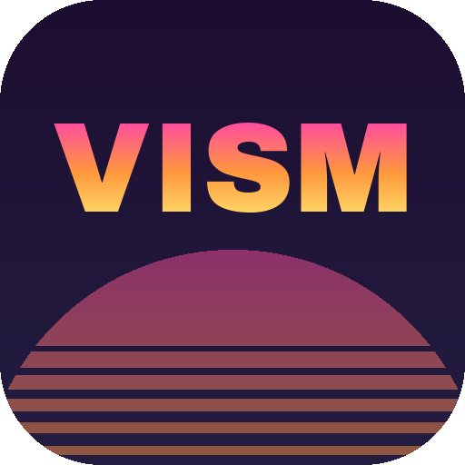

# VI Save Manager

A small Windows app to keep, load and share GTA VI saves for the VIctory-based builds.



## Download

The app tells you when a new version is out.

Get the zip from **Releases**, unzip it anywhere and run `VISaveManager.exe`.
Nothing to install. If Windows says "Windows protected your PC", click **More info → Run anyway**.

## What it does

- **Keep current save**: give where you are a name ("boat") and come back to it later.
- **Load**: switch to any kept save. The save it replaces is backed up first.
- **Share**: turn any save into a zip you can send to someone.
- **Import a save…**: add a zip someone sent you.
- **Start a new game**: clears the story (your settings stay, your old save is backed up).
- **Team saves**: a few saves come with the app, ready to load.

Close the game before loading a save.

## Good to know

- Works with every VIctory-based build: they all use the same save folder,
  `%LOCALAPPDATA%\victory\data\7952987A\saves`.
- Your kept saves and backups are in `%LOCALAPPDATA%\VISaveManager\saves`.
- It only copies save folders, and it contains no game files.
- Its only internet use: at start (and every 6 hours) it asks GitHub whether a newer release of
  this app exists, and shows a banner with a Download button if so. Nothing about you or your
  saves is sent.

## Build it yourself

```powershell
powershell -ExecutionPolicy Bypass -File build.ps1     # build and add a Desktop shortcut
powershell -ExecutionPolicy Bypass -File release.ps1   # make the zip to share (in dist\)
```
